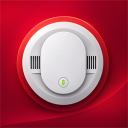

<p align="center">
  
</p>

# homebridge-kidde-smoke-detectors

[](https://github.com/homebridge/plugins/wiki/Verified-Plugins)
[](https://www.npmjs.com/package/homebridge-kidde-smoke-detectors)

A [Homebridge](https://homebridge.io) plugin for **Kidde HomeSafe Wi-Fi smart smoke alarms**: the smoke and smoke + CO models you set up in the **Kidde** app. Each alarm appears in HomeKit as a Smoke Sensor (plus a Carbon Monoxide Sensor on smoke + CO models), with battery, fault and end-of-life status, so the Home app can alert you and run automations when an alarm goes off.

> Using Kidde alarms through the **Ring** app instead? Those are handled by [homebridge-ring-smoke-detectors](https://github.com/simplytoast1/Ring-Smoke-Detectors).

## Supported Alarms

| Alarm | Kidde model | In HomeKit |
|-------|-------------|------------|
| Smart Smoke Alarm (P4010ACS-WF) | `wifidetector` | Smoke |
| Smart Smoke + CO Alarm (P4010ACSCO-WF) | `wifidetector` | Smoke + CO |
| Smart Smoke Alarm with Indoor Air Quality (P4010ACSAQ-WF) | `wifiiaqdetector` | Smoke |
| Smart Smoke + CO Alarm with Indoor Air Quality (P4010ACSCOAQ-WF) | `wifiiaqdetector` | Smoke + CO |
| Smart hardwired Smoke Alarm (20SAR-W) | `EssWFAC` | Smoke |
| Smart hardwired Smoke + CO Alarm (30CUAR-W) | `EssWFAC` | Smoke + CO |

Whether an alarm gets a Carbon Monoxide Sensor is decided by the sensors Kidde says it has, not by the model name, because one model name can cover both versions. Other Kidde HomeSafe devices (CO-only alarms, the Water Leak + Freeze Detector) are not smoke alarms and are skipped.

## What You Get in HomeKit

Each alarm is one accessory with:

- **Smoke Sensor**: smoke detected, plus fault and low-battery status on the tile itself. It also reports smoke when the alarm is sounding because an interconnected alarm elsewhere in the home detected smoke.
- **Carbon Monoxide Sensor** (smoke + CO models): CO detected and the CO level in ppm.
- **Battery**: battery level and low-battery warning.
- **Fault** is shown when the alarm reports an end-of-life warning, a sensor fault (for example the smoke chamber or CO sensor), or device errors.
- **Identify Accessory** in the Home app makes the alarm beep and flash so you can find it (Locate in the Kidde app). It stops on its own after 20 seconds.
- Optional **Hush** and **Test** switches (off by default; see Options).

**Testing an alarm does not set off HomeKit.** Kidde reports a self-test (from the alarm's test button or remotely) separately from smoke and CO, so a test never triggers a HomeKit smoke or CO alert. The plugin notes each test in the Homebridge log.

**No Response is deliberate.** If Kidde reports an alarm as offline, the plugin cannot get fresh data from Kidde for three polling intervals (at least 90 seconds), or Kidde reports an alarm state the plugin cannot read, the alarm shows as **No Response** until fresh, readable data arrives. Kidde marks an alarm offline within seconds of it losing power or its connection, so this shows up within one polling interval. For a smoke alarm, a silent "no smoke" from an alarm nobody can hear from is worse than an obvious "No Response".

**Battery level is approximate.** Most Kidde alarms report a battery *state* (such as "ok" or "low") rather than a percentage, so a healthy battery shows as 100% and a low one as 10%. The low-battery warning is the part to rely on. If an alarm does report a percentage, that number is used.

## Requirements

- Homebridge 1.8 or later (Homebridge 2 supported)
- Node.js 22, 24 or 26
- A Kidde HomeSafe account with your alarms set up and online in the Kidde app

## Setup

1. In the Homebridge UI, go to **Plugins**, search for `homebridge-kidde-smoke-detectors`, and install it.
2. Open the plugin's **Settings**.
3. Under **Kidde Account**, enter the email and password you use in the Kidde app.
4. Click **Sign In & Find Alarms** at the top of the page to check them. Your smoke alarms are listed, each with a **Show in HomeKit** switch and a **Name in HomeKit** box filled in with its current name. Turn off any alarm you don't want in HomeKit, and edit any name you want to change.
5. Click **Save**, then restart Homebridge (or the plugin's child bridge).

The switches and names in the list are stored in the standard **Device Settings** section of the same form, so you can also edit them there.

A name you change later (here, or in the Kidde app) is applied to the alarm and to each of its sensors: "Kitchen" also renames "Kitchen CO" and "Kitchen Battery". A name you gave a sensor in the Home app itself is never overwritten.

The Kidde app may show a notification that a new device signed in. Allow it; denying it may stop the plugin from getting updates.

### Manual configuration

If you prefer to edit `config.json`, add this under `platforms`:

```json
{
  "platform": "KiddeSmokeDetectors",
  "email": "you@example.com",
  "password": "your-kidde-password"
}
```

## Options

All options are in the plugin's settings page.

**Kidde Account**

| Option | Default | Description |
|--------|---------|-------------|
| `email` | *required* | The email address you use in the Kidde app |
| `password` | *required* | Your Kidde app password |

**HomeKit Controls**

| Option | Default | Description |
|--------|---------|-------------|
| `hushSwitch` | `false` | Adds a momentary **Hush** switch to each alarm that silences it, like Hush in the Kidde app. The alarm itself refuses to hush while smoke is too dense. |
| `testSwitch` | `false` | Adds a momentary **Test** switch to each alarm that starts its self-test. The test sounds the siren, and interconnected alarms may sound with it. |
| `identifyLocate` | `true` | Makes Identify Accessory in the Home app locate the alarm (beep and flash) |

Hush and Test are off by default on purpose: a switch can be flipped by a scene, an automation or Siri, and you should decide whether that is something you want for a smoke alarm.

**Device Settings**

A list of per-alarm settings, normally filled in for you by the Show in HomeKit switches and names at the top of the settings page. Each entry has:

| Field | Description |
|-------|-------------|
| `id` | The alarm's serial number or its Kidde device ID, both listed at the top of the settings page. The serial number is best: it stays the same if the alarm is removed from the Kidde app and added again. |
| `name` | A name to use in HomeKit instead of the name from the Kidde app (letters, numbers, spaces and apostrophes, up to 55 characters; anything else is replaced by a space) |
| `hidden` | Keep this alarm out of HomeKit |

**Advanced**

| Option | Default | Description |
|--------|---------|-------------|
| `name` | `Kidde Smoke Detectors` | Name shown in the Homebridge log |
| `pollingInterval` | `15` | Seconds between checks with Kidde (10 to 300) |
| `lowBatteryThreshold` | `20` | For alarms that report a battery percentage: show the low-battery warning at or below this level |
| `locationIds` | all | Only include alarms from these Kidde locations (homes). If none of the IDs match a location on the account (for example a location name was typed instead of its ID), the filter is ignored and a warning is logged, rather than removing every alarm. |
| `debug` | `false` | Write detailed messages to the Homebridge log |

Example with every option:

```json
{
  "platform": "KiddeSmokeDetectors",
  "name": "Kidde Smoke Detectors",
  "email": "you@example.com",
  "password": "your-kidde-password",
  "hushSwitch": false,
  "testSwitch": false,
  "identifyLocate": true,
  "devices": [
    { "id": "918281", "name": "Kitchen Smoke" },
    { "id": "00123456789Z", "hidden": true }
  ],
  "pollingInterval": 15,
  "lowBatteryThreshold": 20,
  "locationIds": ["18271"],
  "debug": false
}
```

## How It Works

1. **Sign in.** The plugin signs in to Kidde's cloud with your email and password, exactly like the Kidde app, and keeps the resulting session in the Homebridge storage folder (readable only by the Homebridge user) so a restart does not sign in again. When Kidde ends the session, the plugin signs in again on its own. If Kidde refuses just one thing (a location your account cannot read, or a Hush the alarm will not accept), the plugin checks that the session still works and does not sign in again, so your account is never hammered with sign-ins.
2. **Poll.** Kidde does not offer a push connection to third-party apps, so the plugin asks Kidde for the state of your alarms every `pollingInterval` seconds. An alarm reaches HomeKit within one interval of Kidde knowing about it.
3. **Update HomeKit.** Each alarm's state is pushed to HomeKit as soon as it changes, so Home app notifications and automations fire without HomeKit having to ask.
4. **Stay honest during outages.** A failed check is retried at the normal interval, then with backoff up to five minutes. Alarms show as No Response while their data is stale, and recover on their own. Staleness is timed on a clock that ignores system time changes, so a Raspberry Pi setting its clock after boot cannot make old data look fresh.
5. **Keep your HomeKit setup.** Each alarm is recognized by its serial number, so removing it in the Kidde app and adding it again keeps the same HomeKit accessory. An alarm is only removed from HomeKit when you hide it, exclude its location, or Kidde has stopped listing it for at least 30 minutes. A temporary empty answer from Kidde never removes anything, and a sensor is never removed because of one unusual answer, so your rooms, names and automations survive Kidde hiccups.

**This plugin supplements, it does not replace.** HomeKit alerts depend on your internet connection, Kidde's cloud and Homebridge all working. Your alarms' own sirens and the Kidde app's notifications remain your primary warning.

## Troubleshooting

**"Kidde rejected the email or password"**: check the credentials in the settings and use Sign In & Find Alarms to test them. If you recently changed your Kidde password, update it here. After a rejected sign-in the plugin waits (1 minute, doubling up to 1 hour) before trying again, so it cannot lock your account. If Kidde's own servers fail while signing in, the wait only grows to 5 minutes, so the plugin is back soon after Kidde is.

**Alarms show No Response**: check the Homebridge log. "Kidde has not reported" or "is offline in Kidde" means Kidde itself has lost touch with the alarm; check its Wi-Fi in the Kidde app. "Could not update from Kidde" means the plugin cannot reach Kidde's cloud; it keeps retrying.

**An alarm is missing**: make sure it is online in the Kidde app, then use Sign In & Find Alarms. If it is listed there with Show in HomeKit off, or marked Location not included, turn it on or change Locations.

**Reporting a problem**: turn on **Debug logging**, restart, reproduce the problem, and include the log in a [GitHub issue](https://github.com/simplytoast1/homebridge-kidde-smoke-detectors/issues). If the log mentions an unrecognized value, please include it so it can be supported.

## Privacy and Security

- Your email and password are stored in Homebridge's `config.json`, like other Homebridge plugins that sign in to a cloud account, and are sent only to Kidde (`api.homesafe.kidde.com`) over HTTPS.
- The Kidde session is stored in the Homebridge storage folder with owner-only permissions. It is tied to your account and never reused for a different email.
- The plugin never logs your password or session, and never follows a redirect that could send your credentials elsewhere.
- The plugin contains no analytics or tracking and contacts no service other than Kidde.

## Development

```bash
npm install
npm test
```

`npm test` builds the plugin and runs the regression suite in `test/`. The tests drive the real compiled plugin against a simulated Kidde cloud, covering alarms, batteries, faults, outages, expired sessions, rejected passwords, restarts and the settings page, without needing a Kidde account. The Kidde client is also run against a real local HTTP server (timeouts, stalled answers, redirects), and a heap check guards against memory growth over thousands of polls.

To check the plugin against a real account, run:

```bash
npm run probe
```

It asks for the Kidde email and password (the password is hidden), signs in once, reads your locations and alarms, and runs the plugin's own code on them to show what HomeKit would get. It changes nothing unless you ask: `--locate <id>` makes one alarm beep for 5 seconds, and `--self-test <id>` starts a real self-test after you type TEST. `--watch <minutes>` keeps polling and prints every change Kidde reports. It writes a report to `probe-reports/` with no password, cookie, token or email address in it, which is useful to attach to an issue. Run `npm run probe -- --help` for every option.

## Credits

This plugin builds on the reverse-engineering work of the Kidde HomeSafe community:

- **[@865charlesw](https://github.com/865charlesw)**: [kidde-homesafe](https://github.com/865charlesw/kidde-homesafe), the original Python client for the HomeSafe API
- **[@tache](https://github.com/tache)** and contributors: [homeassistant-kidde](https://github.com/tache/homeassistant-kidde), whose device data, wiki and issue history document the models and fields this plugin relies on
- **[@sjodin](https://github.com/sjodin)**: [homebridge-kidde](https://github.com/sjodin/homebridge-kidde), the first Homebridge plugin for Kidde HomeSafe
- **[luxardolabs](https://github.com/luxardolabs)**: [kidde-collector](https://github.com/luxardolabs/kidde-collector), for its notes on session handling and offline devices

Kidde and HomeSafe are trademarks of their respective owners. This project is not affiliated with or endorsed by Kidde.

## License

MIT
